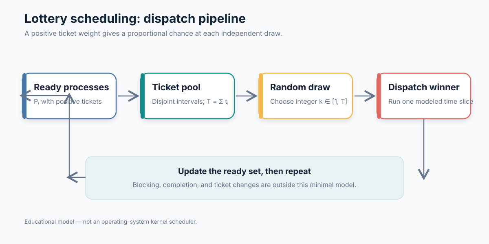
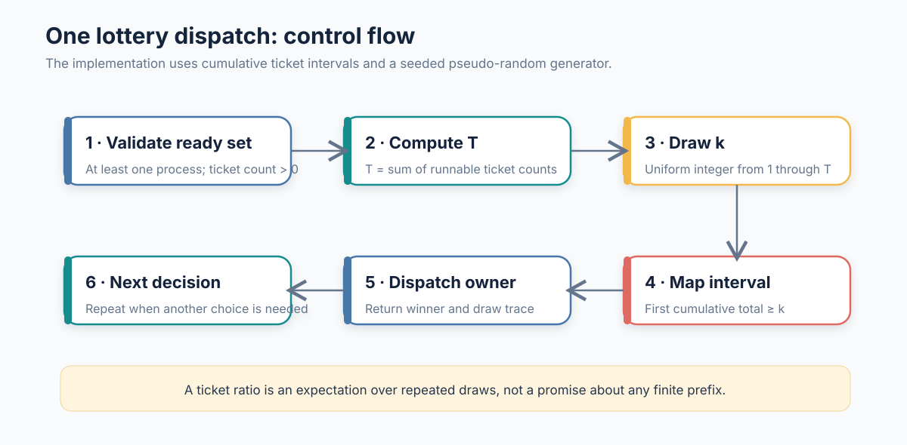
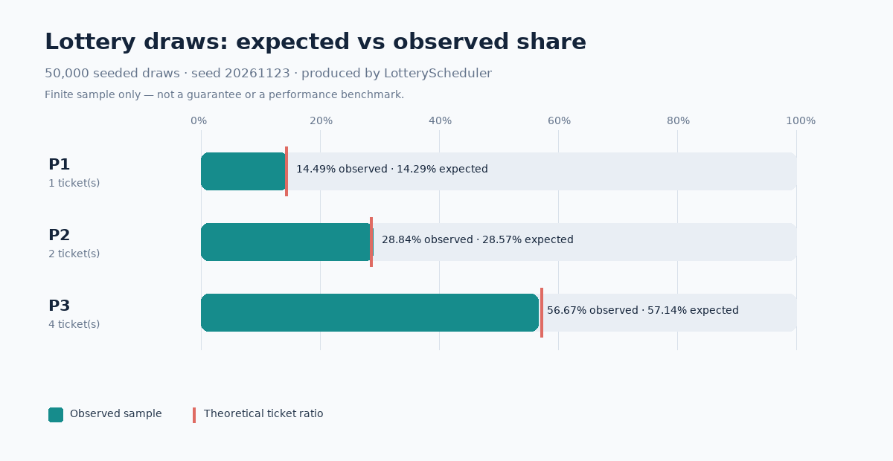

<div dir="rtl" align="right">

# تمرین ۱ — معرفی الگوریتم زمان‌بندی لاتاری

## وضعیت و دامنه

این پوشه یک **پیاده‌سازی آموزشی تازه** برای معرفی Lottery Scheduling است؛ در مخزن اولیه کد یا گزارش این تمرین موجود نبود. این برنامه زمان‌بند هستهٔ سیستم‌عامل نیست و نتایج آن عملکرد واقعی CPU را اندازه‌گیری نمی‌کند.

## مسئله و ایدهٔ اصلی

زمان‌بند باید از میان پردازه‌های آماده، پردازهٔ بعدی را انتخاب کند. در روش لاتاری به هر پردازه تعداد مثبت و صحیحی بلیت داده می‌شود. یک بلیت به‌طور یکنواخت از کل بلیت‌های پردازه‌های آماده انتخاب می‌شود و صاحب آن بلیت برندهٔ همان نوبت است.

اگر پردازهٔ `i` تعداد `tᵢ` بلیت و مجموع بلیت‌ها `T = Σ tᵢ` باشد، احتمال انتخاب آن در یک قرعه‌کشی مستقل برابر است با:

`P(i) = tᵢ / T`

این نسبت **امید ریاضی در قرعه‌کشی‌های تکراری** است؛ تضمین نمی‌کند که هر دنبالهٔ کوتاه دقیقاً همین نسبت را داشته باشد.

## نمودارها

**شکل ۱ — مسیر انتخاب:** پردازه‌های آماده، بازه‌های بلیت، قرعه‌کشی یکنواخت و تحویل نوبت. این شکل معماری مفهومی مدل را نشان می‌دهد، نه جزئیات زمان‌بند هسته.



**شکل ۲ — جریان کنترل یک انتخاب:** مجموع بلیت‌ها محاسبه می‌شود، عددی در بازهٔ بستهٔ `1..T` انتخاب و به اولین بازهٔ تجمعی شامل آن عدد نگاشت می‌شود.



**شکل ۳ — یک اجرای داده‌محور:** ۵۰٬۰۰۰ انتخاب با seed ثابت `20261123` روی وزن‌های ۱، ۲ و ۴. میله‌ها فراوانی مشاهده‌شده را نشان می‌دهند و خط مرجانی نسبت نظری بلیت است. اختلاف محدود نمونه با نسبت نظری طبیعی است؛ این نمودار معیار کارایی یا تضمین نوبت نیست.



دادهٔ دقیق شکل سوم در [`outputs/lottery-frequency.csv`](outputs/lottery-frequency.csv) قرار دارد.

## اجرای برنامه

پیش‌نیاز: Python نسخهٔ ۳٫۱۱ یا جدیدتر. کد زمان‌بند و تست‌ها فقط از کتابخانهٔ استاندارد Python استفاده می‌کنند.

```bash
python -m pip install -e .
python examples/run_lottery_demo.py
python -m unittest discover -s tests -v
```

برای بازتولید نمودارها و CSVهای آزمایش:

```bash
python -m pip install -e ".[docs]"
python tools/generate_figures.py
```

برای تولید PNG، نصب اختیاری Pillow لازم است. اجرای فایل مولد از ریشهٔ مخزن انجام می‌شود.

### نمونهٔ استفاده از کد

```python
from lottery_lab import LotteryScheduler, Process

scheduler = LotteryScheduler(
    [Process("interactive", 6), Process("batch", 3), Process("background", 1)],
    seed=20261123,
)
for draw in scheduler.run(5):
    print(draw.winning_ticket, draw.process.name)
```

بذر ثابت فقط برای بازتولید مثال آموزشی است؛ برای هر seed دیگر دنباله می‌تواند متفاوت باشد.

## اجزای پروژه

```text
src/lottery_lab/lottery.py       اعتبارسنجی پردازه‌ها و قرعه‌کشی وزن‌دار
examples/run_lottery_demo.py    اجرای نمونهٔ قابل بازتولید
 tests/test_lottery.py          آزمون بازهٔ بلیت، نسبت نظری، ورودی مرزی و تکرارپذیری
 docs/README.md                 راهنمای فنی و تفسیر شکل‌ها
 docs/reports/report-fa.md      یادداشت فنی فارسی
 docs/reports/report-en.md      English technical note
 docs/figures/                  دو نمودار ساختاری و نمودارهای داده‌محور
 outputs/lottery-frequency.csv  دادهٔ واقعی مولد نمودار با seed ثبت‌شده
```

## نتیجه و محدودیت‌ها

این نمونه نشان می‌دهد چگونه وزن نسبی با تعداد بلیت به احتمال انتخاب تبدیل می‌شود و چگونه seed ثابت امکان بازتولید trace را می‌دهد. پیاده‌سازی، زمان اجرای پردازه، وقفه، blocking، تغییر پویای بلیت، هزینهٔ context switch، پردازندهٔ چند‌هسته‌ای و fairness تضمینی را مدل نمی‌کند. برای تحلیل کامل‌تر، فرض‌ها، اجزای کد، جدول داده و روش بازتولید در [`docs/README.md`](docs/README.md) آمده است.

این یادداشت‌ها گزارش آغازین مستند به کد فعلی‌اند و **گزارش Word/PDF چهل‌صفحه‌ای نیستند**؛ صفحه‌سازی یا افزودن نتیجهٔ ساختگی انجام نشده است.

</div>
