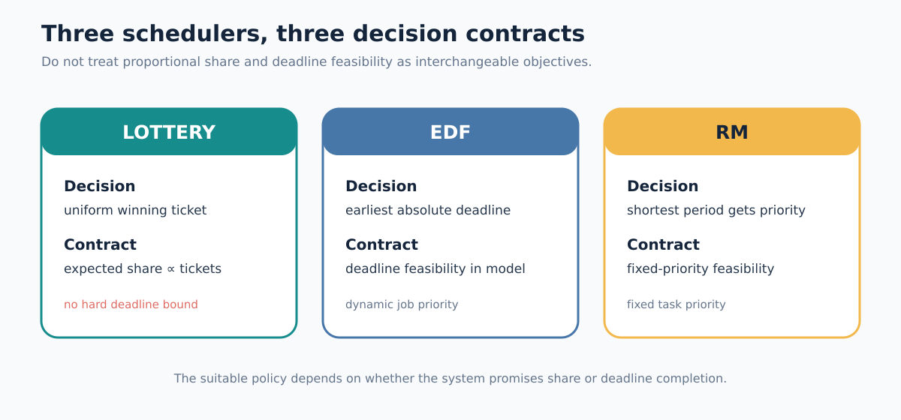
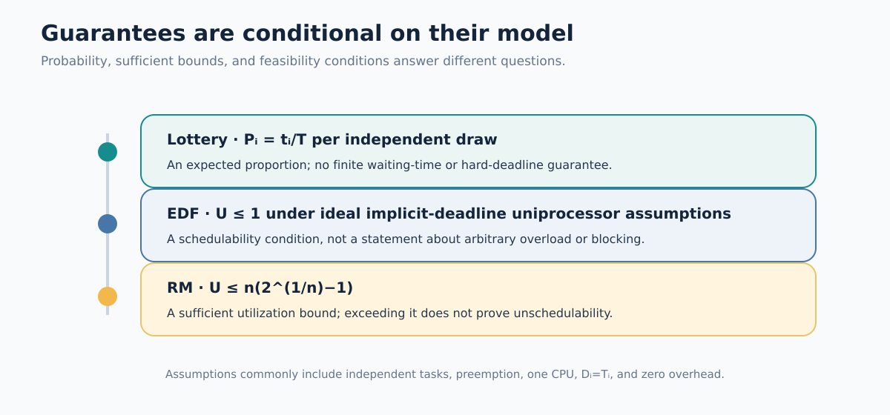

<div dir="rtl" align="right">

# تمرین ۲ — مقایسهٔ Lottery Scheduling با EDF و RM

## سه هدف متفاوت

- **Lottery Scheduling:** توزیع احتمالاتیِ سهم نسبی CPU با وزن بلیت‌ها.
- **EDF:** اولویت پویا بر اساس نزدیک‌ترین مهلت مطلق job آماده.
- **RM:** اولویت ثابت بر اساس دوره؛ دورهٔ کوتاه‌تر، اولویت بالاتر.





## نکات مقایسه

Lottery به‌تنهایی آزمون schedulability و تضمین deadline ندارد. EDF در مدل استاندارد تک‌پردازنده‌ای، preemptive، independent، با `Dᵢ=Tᵢ` و سربار صفر، با `U≤1` زمان‌پذیر است. RM از اولویت ثابت استفاده می‌کند؛ حد Liu–Layland برای `n` کار، `U≤n(2^(1/n)-1)`، یک **حد کافی** است و ردشدن از آن عدم زمان‌پذیری را ثابت نمی‌کند.

گرسنگی را هم باید با workload و سیاست تعریف کرد: Lottery با chance مثبت، انتظار محدود را تضمین نمی‌کند؛ RM می‌تواند در بار بالای اولویت‌ها کار کم‌اولویت را عقب بیندازد؛ EDF نیز در overload ممکن است deadline miss داشته باشد، اما این‌ها را نباید بدون فرض‌ها با یک ادعای مطلق «starvation» یکی دانست.

## مقایسهٔ تفصیلی

| ویژگی | Lottery | EDF | RM |
|---|---|---|---|
| هدف مستقیم | سهم نسبی مورد انتظار | رعایت مهلت با اولویت پویای absolute deadline | زمان‌بندی ثابت‌اولویت دوره‌ای |
| مبنای انتخاب | قرعهٔ یکنواخت از بلیت‌های آماده | کمترین deadline مطلق | کمترین period در among ready jobs |
| اولویت | احتمالاتی/وزن‌دار | پویا در هر release/deadline change | ثابت برای هر task |
| ادعای استاندارد | `Pᵢ=tᵢ/T` در هر draw مستقل | `U≤1` در مدل implicit-deadline تک‌پردازنده‌ای | حد Liu–Layland کافی؛ response-time analysis دقیق‌تر |
| deadline سخت | تضمین نمی‌کند | می‌تواند در فرض‌های مدل تضمین کند | می‌تواند در فرض‌های مدل و آزمون کافی/دقیق تضمین کند |
| انتظار/گرسنگی | finite waiting bound ندارد | در workload شدنی، همهٔ jobها deadline می‌رسند؛ overload نیازمند تحلیل | fixed priority ممکن است کارهای کم‌اولویت را عقب بیندازد؛ feasibility باید آزموده شود |
| tie-break | شمارهٔ ticket | در این simulator: release زودتر، سپس ورودی | در این simulator: ورودی task، سپس release |
| پیاده‌سازی آموزشی | cumulative scan، O(n) برای draw | scan آماده‌ها، O(J) در این مدل | scan آماده‌ها، O(J) در این مدل |
| محدودیت مهم | نوسان نمونه و وابستگی به ticket policy | حساس به فرض‌ها/overhead/داوری deadline | آزمون bound کافی است نه لازم؛ priority inversion باید جدا مدیریت شود |

## مثال مرتبط با task set موجود

تمرین ۳ در remote یک task set واقعیِ درون مخزن دارد: `(C,T,D)=(1,4,4),(1,5,5),(2,10,10)`. utilization آن `0.65` و hyperperiod آن `20` است؛ EDF و RM در شبیه‌سازی موجود همهٔ deadlineها را رعایت کردند و trace این مثال یکسان شد. برای Lottery، ticket counts این taskها در ورودی‌های در دسترس تعیین نشده‌اند؛ بنابراین سهم Lottery روی همین task set عددگذاری نشده است. نمودار زمان‌بندی در [Exercise 3](../03-edf-rm-three-processes/README.md) است.

## بازتولید و منابع

```bash
python -m pip install -e .
python -m unittest discover -s tests -v
python tools/generate_figures.py
```

منابع اصلی Waldspurger & Weihl (OSDI 1994) برای Lottery و Liu & Layland (JACM 1973) برای EDF/RM در [`references.md`](references.md) آمده‌اند. متادیتا و ادعاهای ارجاع‌شده در [`../../docs/research-source-audit.md`](../../docs/research-source-audit.md) بررسی شده‌اند.

یادداشت‌های فارسی و انگلیسی در `docs/reports/` قرار دارند. این نسخه تحلیلی است و ۴۰ صفحه برای هر زبان یا Word/PDF نهایی تولید نشده است.

</div>
