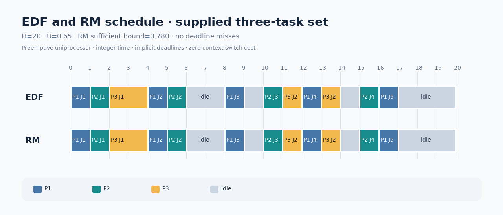

<div dir="rtl" align="right">

# تمرین ۳ — زمان‌بندی EDF و RM برای سه پردازه

## ورودی و فرض‌ها

پارامترهای task set از گزارش موجود در شاخهٔ remote `assignment-03-edf-rm-three-processes` خوانده شده‌اند؛ مقدار جدیدی برای taskها فرض نشده است.

| کار | زمان اجرا `Cᵢ` | دوره `Tᵢ` | مهلت نسبی `Dᵢ` |
|---|---:|---:|---:|
| P1 | 1 | 4 | 4 |
| P2 | 1 | 5 | 5 |
| P3 | 2 | 10 | 10 |

همهٔ کارها مستقل و در `t=0` آزاد می‌شوند. پردازنده تک‌هسته‌ای و preemptive، هزینهٔ تعویض متن صفر، و مهلت‌ها implicit (`Dᵢ=Tᵢ`) فرض شده‌اند. زمان‌ها واحدهای گسستهٔ صحیح‌اند.

## محاسبه و نتیجه

`U = 1/4 + 1/5 + 2/10 = 0.65` و `H = lcm(4,5,10)=20`. حد کافی RM برای سه task برابر `3(2^(1/3)-1) ≈ 0.7798` است؛ چون `U` پایین‌تر است، آزمون کافی Liu–Layland در همین مدل schedulability را تضمین می‌کند. EDF نیز در مدل تک‌پردازندهٔ preemptive با deadlineهای برابر دوره‌ها شرط `U≤1` را برآورده می‌کند.

شبیه‌ساز بازتولیدپذیر هر دو سیاست را در بازهٔ `[0,20)` اجرا کرد و هیچ deadline miss ثبت نشد. دو trace در این task set یکسان‌اند؛ این نتیجه را نباید به task setهای دیگر تعمیم داد.

## نمودار گانت



در هر خط یک سیاست و در هر مستطیل یک job است؛ بخش خاکستری زمان idle را نشان می‌دهد. محور زمان `[0,20)` است. خروجی کامل در [`outputs/edf-rm-schedule.csv`](outputs/edf-rm-schedule.csv) آمده است.

## برنامهٔ زمان‌بندی (هر بازه نیمه‌باز است)

| بازه | EDF | RM | توضیح |
|---|---|---|---|
| `[0,1)` | P1/J1 | P1/J1 | deadline مطلق 4 |
| `[1,2)` | P2/J1 | P2/J1 | deadline مطلق 5 |
| `[2,4)` | P3/J1 | P3/J1 | deadline مطلق 10 |
| `[4,5)` | P1/J2 | P1/J2 | deadline مطلق 8 |
| `[5,6)` | P2/J2 | P2/J2 | deadline مطلق 10 |
| `[6,8)` | idle | idle | هیچ job آماده‌ای وجود ندارد |
| `[8,9)` | P1/J3 | P1/J3 | deadline مطلق 12 |
| `[9,10)` | idle | idle | — |
| `[10,11)` | P2/J3 | P2/J3 | deadline مطلق 15 |
| `[11,12)` | P3/J2 | P3/J2 | deadline مطلق 20 |
| `[12,13)` | P1/J4 | P1/J4 | deadline مطلق 16؛ P3/J2 موقتاً preempt می‌شود |
| `[13,14)` | P3/J2 | P3/J2 | تکمیل P3/J2 پیش از deadline 20 |
| `[14,15)` | idle | idle | — |
| `[15,16)` | P2/J4 | P2/J4 | deadline مطلق 20 |
| `[16,17)` | P1/J5 | P1/J5 | deadline مطلق 20 |
| `[17,20)` | idle | idle | پایان hyperperiod |

## اجرای کد و آزمون

```bash
python -m pip install -e .
python tools/generate_figures.py
python -m unittest discover -s tests -v
```

مدل EDF/RM در [`src/lottery_lab/realtime.py`](../../src/lottery_lab/realtime.py) است. زمان‌بند هر واحد زمان، taskهای آزادشده را بررسی می‌کند و job را طبق deadline مطلق (EDF) یا دورهٔ task (RM) انتخاب می‌کند؛ tie-break ثابت است. این ابزار آموزشی است و تحلیل fixed-point یا زمان‌بندی با زمان اجرای غیرصحیح را پوشش نمی‌دهد.

</div>
