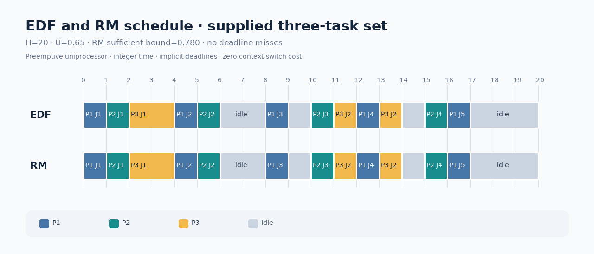

# Exercise 3 — Hand Schedule of EDF and RM for Three Tasks

## Abstract

This report hand-schedules the three-task set recorded in the original assignment branch over one hyperperiod, then checks the manual trace against the repository simulator. The model assumes independent tasks, synchronous release at time zero, a preemptive single processor, implicit deadlines (`D=T`), integer execution times, and zero context-switch/scheduler cost. The task parameters are `(C,T,D)=(1,4,4),(1,5,5),(2,10,10)`. The by-hand schedule and code check agree; the simulator is a verification aid, not the source of the hand derivation.

## 1. Task set and assumptions

| Task | Execution `Cᵢ` | Period `Tᵢ` | Relative deadline `Dᵢ` | RM priority |
|---|---:|---:|---:|---|
| P1 | 1 | 4 | 4 | Highest |
| P2 | 1 | 5 | 5 | Middle |
| P3 | 2 | 10 | 10 | Lowest |

All tasks release their first job at `t=0`. Later jobs release at integer multiples of their periods. We schedule the half-open interval `[0,20)`, where the hyperperiod is `H=lcm(4,5,10)=20`. The processor is one-core and preemptive at integer time boundaries; there is no execution blocking, release jitter, shared-resource blocking, or scheduling overhead. Relative deadlines equal periods, so each job's absolute deadline is its release time plus its period.

The utilization is

`U = 1/4 + 1/5 + 2/10 = 0.65`.

For three tasks, the Liu–Layland sufficient RM bound is `3(2^(1/3)-1)≈0.779763`; `0.65` is below it. For the ideal independent, preemptive, implicit-deadline uniprocessor model, EDF is feasible when `U≤1` [1]. These theorem checks provide context; the timeline below is still written out by hand.

## 2. Release and deadline events

| Task | Releases in `[0,20)` | Absolute deadlines in `[0,20]` |
|---|---|---|
| P1 | 0, 4, 8, 12, 16 | 4, 8, 12, 16, 20 |
| P2 | 0, 5, 10, 15 | 5, 10, 15, 20 |
| P3 | 0, 10 | 10, 20 |

RM's fixed priority order follows the periods: `P1 > P2 > P3`. EDF compares the absolute deadlines of currently released, unfinished jobs. At each boundary below, choose the ready job with the smallest EDF deadline, or the highest RM task priority. When the same task continues, adjacent units combine into one interval.

## 3. Hand derivation of the schedule

1. **`t=0`:** P1/J1 has deadline 4, P2/J1 deadline 5, and P3/J1 deadline 10. EDF chooses P1; RM also chooses highest-priority P1. P1 uses `[0,1)` and completes its one unit.
2. **`t=1`:** P2/J1 (deadline 5) precedes P3/J1 (deadline 10) under EDF; RM gives P2 priority over P3. P2 completes in `[1,2)`.
3. **`t=2`:** only P3/J1 remains. It needs two units, so it runs continuously through `[2,4)` and completes before deadline 10.
4. **`t=4`:** P1/J2 releases with deadline 8. It is the only ready job and runs `[4,5)`, completing before deadline 8.
5. **`t=5`:** P2/J2 releases with deadline 10. It runs `[5,6)` and completes before its deadline. No job is ready in `[6,8)`, so the processor is idle.
6. **`t=8`:** P1/J3 releases with deadline 12 and runs `[8,9)`. There is no ready job in `[9,10)`.
7. **`t=10`:** P2/J3 (deadline 15) and P3/J2 (deadline 20, two units) release. EDF chooses P2 because 15 is earlier than 20; RM chooses P2 because its period is shorter. P2 completes in `[10,11)`.
8. **`t=11`:** P3/J2 is the only ready job. It runs one unit in `[11,12)`, with one unit left.
9. **`t=12`:** P1/J4 releases with deadline 16. EDF selects it ahead of P3/J2's deadline 20; RM selects higher-priority P1. P1 completes `[12,13)`. P3/J2 resumes for its final unit in `[13,14)` and completes before deadline 20.
10. **`t=14`:** no job is ready, so the processor is idle until P2/J4 releases at 15.
11. **`t=15`:** P2/J4 runs `[15,16)` and completes before deadline 20.
12. **`t=16`:** P1/J5 releases with deadline 20 and runs `[16,17)`. It completes before deadline. The remainder `[17,20)` is idle; the next releases at `t=20` belong to the next hyperperiod and are excluded.

The selected job is the same under EDF and RM at every interval for this input. That coincidence is specific to this workload; EDF and RM are not generally equivalent.

## 4. Resulting schedule table

Every interval is half-open. A `Jk` label denotes the kth job of that periodic task.

| Interval | EDF | RM | Hand-check |
|---|---|---|---|
| `[0,1)` | P1/J1 | P1/J1 | Deadline 4; highest RM priority |
| `[1,2)` | P2/J1 | P2/J1 | Deadline 5; higher than P3 |
| `[2,4)` | P3/J1 | P3/J1 | Two units complete by deadline 10 |
| `[4,5)` | P1/J2 | P1/J2 | Release 4, deadline 8 |
| `[5,6)` | P2/J2 | P2/J2 | Release 5, deadline 10 |
| `[6,8)` | idle | idle | No released unfinished jobs |
| `[8,9)` | P1/J3 | P1/J3 | Release 8, deadline 12 |
| `[9,10)` | idle | idle | No released unfinished jobs |
| `[10,11)` | P2/J3 | P2/J3 | Deadline 15 precedes P3's 20 |
| `[11,12)` | P3/J2 | P3/J2 | First unit of two |
| `[12,13)` | P1/J4 | P1/J4 | Deadline 16 precedes P3's 20 |
| `[13,14)` | P3/J2 | P3/J2 | Final unit, completes by 20 |
| `[14,15)` | idle | idle | No released unfinished jobs |
| `[15,16)` | P2/J4 | P2/J4 | Release 15, deadline 20 |
| `[16,17)` | P1/J5 | P1/J5 | Release 16, deadline 20 |
| `[17,20)` | idle | idle | End of hyperperiod |

## 5. Deadline audit

| Job | Release | Completion | Absolute deadline | Result |
|---|---:|---:|---:|---|
| P1/J1 | 0 | 1 | 4 | Meets |
| P1/J2 | 4 | 5 | 8 | Meets |
| P1/J3 | 8 | 9 | 12 | Meets |
| P1/J4 | 12 | 13 | 16 | Meets |
| P1/J5 | 16 | 17 | 20 | Meets |
| P2/J1 | 0 | 2 | 5 | Meets |
| P2/J2 | 5 | 6 | 10 | Meets |
| P2/J3 | 10 | 11 | 15 | Meets |
| P2/J4 | 15 | 16 | 20 | Meets |
| P3/J1 | 0 | 4 | 10 | Meets |
| P3/J2 | 10 | 14 | 20 | Meets |

Busy time is `5×1 + 4×1 + 2×2 = 13` units, matching `U×H=0.65×20=13`. Idle time is seven units. The deadline audit is consistent with the table and the utilization calculation.

## 6. Gantt figure and executable cross-check



The Gantt chart is generated from the hand schedule and checked against `src/lottery_lab/realtime.py`; the CSV trace is the [hand-schedule data](../../outputs/edf-rm-schedule.csv). The code uses integer ticks, preempts at tick boundaries, assumes zero overhead, and reports misses at job deadlines. Agreement between table and code catches transcription or tie-break errors for this one case; it does not prove the theorem for all task sets or validate real hardware behavior.

## 7. Reproduction and references

```bash
python -m pip install -e .
python tools/generate_figures.py
python -m unittest discover -s tests -v
```

1. Liu, C. L., and James W. Layland. “Scheduling Algorithms for Multiprogramming in a Hard-Real-Time Environment.” *Journal of the ACM* 20(1), 46–61, January 1973. DOI: 10.1145/321738.321743.
2. The input parameters are transcribed from the original Exercise 3 branch's report, recorded in the [historic branch audit](../../../../docs/remote-branch-audit.md). The source paper does not supply this particular task set.

Source-check notes: [the source-audit record](../../../../docs/research-source-audit.md).
