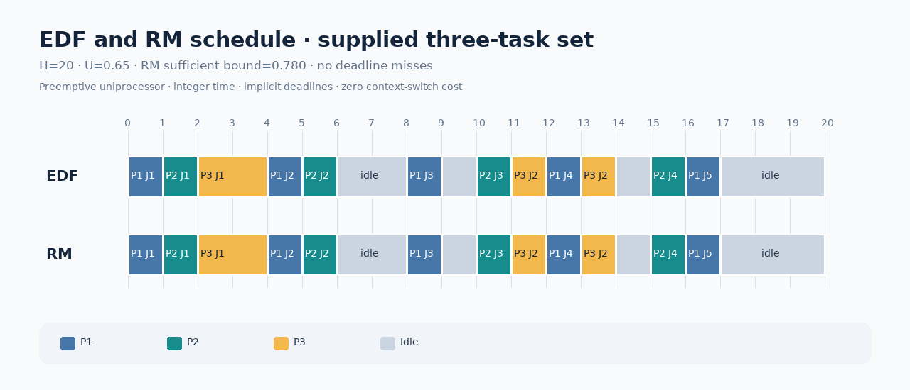

<div dir="rtl" align="right">

# تمرین ۳ — زمان‌بندی دستی EDF و RM برای سه task

## چکیده

این گزارش task set سه‌تایی ثبت‌شده در شاخهٔ اصلی تمرین را در یک ابر‌دوره به‌صورت دستی زمان‌بندی می‌کند و سپس نتیجهٔ دستی را با شبیه‌ساز مخزن می‌سنجد. فرض‌ها: taskهای مستقل، release هم‌زمان در زمان صفر، پردازندهٔ تک‌هسته‌ای و پیش‌دستانه، deadline ضمنی (`D=T`)، زمان اجرای صحیح، و هزینهٔ تعویض متن/زمان‌بندی صفر. پارامترها `(C,T,D)=(1,4,4),(1,5,5),(2,10,10)` هستند. جدول دستی و بررسی کد هم‌خوانند؛ شبیه‌ساز ابزار راستی‌آزمایی است، نه منبع استخراج دستی.

## ۱. task set و فرض‌ها

| Task | زمان اجرا `Cᵢ` | دوره `Tᵢ` | deadline نسبی `Dᵢ` | اولویت RM |
|---|---:|---:|---:|---|
| P1 | 1 | 4 | 4 | بالاترین |
| P2 | 1 | 5 | 5 | میانی |
| P3 | 2 | 10 | 10 | پایین‌ترین |

همهٔ taskها job اول را در `t=0` آزاد می‌کنند. jobهای بعدی در مضرب صحیح دوره آزاد می‌شوند. بازهٔ نیمه‌باز `[0,20)` را زمان‌بندی می‌کنیم؛ ابر‌دوره `H=lcm(4,5,10)=20` است. پردازنده یک هسته دارد، در مرز زمان‌های صحیح preemptive است و execution blocking، release jitter، blocking منبع مشترک یا هزینهٔ زمان‌بندی ندارد. چون deadline نسبی برابر دوره است، deadline مطلق هر job از جمع release و period به دست می‌آید.

استفاده از پردازنده:

`U = 1/4 + 1/5 + 2/10 = 0.65`.

حد کافی Liu–Layland برای RM با سه task برابر `3(2^(1/3)-1)≈0.779763` است؛ `0.65` از آن پایین‌تر است. برای مدل ایده‌آل taskهای مستقل، preemptive و implicit-deadline روی تک‌پردازنده، EDF وقتی `U≤1` باشد شدنی است [۱]. این آزمون‌ها زمینهٔ قضیه را می‌دهند؛ خط زمان زیر همچنان دستی نوشته شده است.

## ۲. رویدادهای release و deadline

| Task | releaseها در `[0,20)` | deadlineهای مطلق در `[0,20]` |
|---|---|---|
| P1 | 0, 4, 8, 12, 16 | 4, 8, 12, 16, 20 |
| P2 | 0, 5, 10, 15 | 5, 10, 15, 20 |
| P3 | 0, 10 | 10, 20 |

ترتیب اولویت ثابت RM از دوره‌ها می‌آید: `P1 > P2 > P3`. EDF deadline مطلق jobهای آزادشده و تمام‌نشده را مقایسه می‌کند. در هر مرز پایین، job با کمترین deadline مطلق برای EDF یا task با بالاترین اولویت RM انتخاب می‌شود. واحدهای پیوسته به یک بازه ادغام شده‌اند.

## ۳. استخراج دستی برنامه

۱. **`t=0`:** P1/J1 deadline 4، P2/J1 deadline 5 و P3/J1 deadline 10 دارد. EDF ابتدا P1 را می‌گیرد؛ RM نیز P1 با اولویت بالاتر را انتخاب می‌کند. P1 در `[0,1)` اجرا و یک واحدش تمام می‌شود.
۲. **`t=1`:** در EDF، deadline 5 برای P2/J1 قبل از deadline 10 برای P3/J1 است؛ در RM نیز P2 از P3 اولویت بالاتری دارد. P2 در `[1,2)` تمام می‌شود.
۳. **`t=2`:** فقط P3/J1 باقی است. دو واحد لازم دارد؛ پس پیوسته در `[2,4)` اجرا می‌شود و پیش از deadline 10 تمام می‌شود.
۴. **`t=4`:** P1/J2 با deadline 8 آزاد می‌شود. تنها job آماده است و در `[4,5)` اجرا می‌شود؛ قبل از deadline تمام می‌شود.
۵. **`t=5`:** P2/J2 با deadline 10 آزاد می‌شود. در `[5,6)` اجرا و تمام می‌شود. در `[6,8)` job آماده‌ای نیست و CPU بیکار است.
۶. **`t=8`:** P1/J3 با deadline 12 آزاد و در `[8,9)` اجرا می‌شود. در `[9,10)` job آماده‌ای وجود ندارد.
۷. **`t=10`:** P2/J3 با deadline 15 و P3/J2 با deadline 20 و نیاز دو واحد آزاد می‌شوند. EDF چون 15 قبل از 20 است P2 را انتخاب می‌کند؛ RM نیز به دلیل دورهٔ کوتاه‌تر P2 را می‌گیرد. P2 در `[10,11)` تمام می‌شود.
۸. **`t=11`:** تنها P3/J2 آماده است. یک واحد در `[11,12)` اجرا می‌کند و یک واحد باقی می‌ماند.
۹. **`t=12`:** P1/J4 با deadline 16 آزاد می‌شود. EDF آن را بر P3/J2 با deadline 20 مقدم می‌کند؛ RM نیز به P1 اولویت می‌دهد. P1 در `[12,13)` تمام می‌شود؛ P3/J2 واحد آخر را در `[13,14)` اجرا کرده و پیش از deadline 20 تکمیل می‌شود.
۱۰. **`t=14`:** job آماده‌ای نیست؛ CPU تا release بعدی P2/J4 در زمان 15 بیکار است.
۱۱. **`t=15`:** P2/J4 در `[15,16)` اجرا و قبل از deadline 20 تمام می‌شود.
۱۲. **`t=16`:** P1/J5 با deadline 20 آزاد می‌شود و در `[16,17)` تمام می‌شود. در `[17,20)` CPU بیکار است؛ releaseهای `t=20` مربوط به ابر‌دورهٔ بعدند و در بازهٔ حاضر نیستند.

در تمام بازه‌های این ورودی EDF و RM job یکسانی را انتخاب می‌کنند. این اتفاق فقط به همین workload مربوط است؛ EDF و RM به‌طور کلی هم‌ارز نیستند.

## ۴. جدول نهایی زمان‌بندی

هر بازه نیمه‌باز است. `Jk` یعنی job شمارهٔ `k` از task دوره‌ای.

| بازه | EDF | RM | بررسی دستی |
|---|---|---|---|
| `[0,1)` | P1/J1 | P1/J1 | deadline برابر 4؛ اولویت بالاتر RM |
| `[1,2)` | P2/J1 | P2/J1 | deadline 5؛ بالاتر از P3 |
| `[2,4)` | P3/J1 | P3/J1 | دو واحد پیش از deadline 10 تمام می‌شود |
| `[4,5)` | P1/J2 | P1/J2 | release 4، deadline 8 |
| `[5,6)` | P2/J2 | P2/J2 | release 5، deadline 10 |
| `[6,8)` | idle | idle | job آزادشدهٔ ناتمام وجود ندارد |
| `[8,9)` | P1/J3 | P1/J3 | release 8، deadline 12 |
| `[9,10)` | idle | idle | job آزادشدهٔ ناتمام وجود ندارد |
| `[10,11)` | P2/J3 | P2/J3 | deadline 15 زودتر از 20 برای P3 است |
| `[11,12)` | P3/J2 | P3/J2 | واحد اول از دو واحد |
| `[12,13)` | P1/J4 | P1/J4 | deadline 16 زودتر از 20 برای P3 است |
| `[13,14)` | P3/J2 | P3/J2 | واحد آخر، تکمیل تا 20 |
| `[14,15)` | idle | idle | job آماده وجود ندارد |
| `[15,16)` | P2/J4 | P2/J4 | release 15، deadline 20 |
| `[16,17)` | P1/J5 | P1/J5 | release 16، deadline 20 |
| `[17,20)` | idle | idle | پایان ابر‌دوره |

## ۵. بررسی deadlineها

| Job | release | زمان تکمیل | deadline مطلق | نتیجه |
|---|---:|---:|---:|---|
| P1/J1 | 0 | 1 | 4 | رعایت شد |
| P1/J2 | 4 | 5 | 8 | رعایت شد |
| P1/J3 | 8 | 9 | 12 | رعایت شد |
| P1/J4 | 12 | 13 | 16 | رعایت شد |
| P1/J5 | 16 | 17 | 20 | رعایت شد |
| P2/J1 | 0 | 2 | 5 | رعایت شد |
| P2/J2 | 5 | 6 | 10 | رعایت شد |
| P2/J3 | 10 | 11 | 15 | رعایت شد |
| P2/J4 | 15 | 16 | 20 | رعایت شد |
| P3/J1 | 0 | 4 | 10 | رعایت شد |
| P3/J2 | 10 | 14 | 20 | رعایت شد |

زمان busy برابر `5×1+4×1+2×2=13` واحد است و با `U×H=0.65×20=13` برابر می‌شود. زمان idle هفت واحد است. جدول deadline با schedule و محاسبهٔ utilization سازگار است.

## ۶. شکل گانت و بررسی اجرایی



نمودار از برنامهٔ دستی تولید و با `src/lottery_lab/realtime.py` سنجیده شده است؛ CSV در [دادهٔ برنامهٔ دستی](../../outputs/edf-rm-schedule.csv) قرار دارد. کد از tick صحیح، preemption در مرز tick، سربار صفر و ثبت miss هنگام deadline استفاده می‌کند. توافق جدول و کد، خطای رونویسی یا tie-break را برای همین ورودی پیدا می‌کند؛ قضیه‌ای برای همهٔ taskها اثبات نمی‌کند و رفتار سخت‌افزار واقعی را اعتبارسنجی نمی‌کند.

## ۷. بازتولید و منابع

```bash
python -m pip install -e .
python tools/generate_figures.py
python -m unittest discover -s tests -v
```

۱. Liu, C. L., and James W. Layland. “Scheduling Algorithms for Multiprogramming in a Hard-Real-Time Environment.” *Journal of the ACM* 20(1), 46–61, January 1973. DOI: 10.1145/321738.321743.
۲. پارامترهای ورودی از گزارش شاخهٔ اولیهٔ Exercise 3 رونویسی شده‌اند؛ ثبت آن در [حسابرسی شاخهٔ اولیه](../../../../docs/remote-branch-audit.md) است. مقالهٔ مرجع این task set خاص را ارائه نمی‌کند.

یادداشت بررسی منابع: [حسابرسی منبع](../../../../docs/research-source-audit.md).

</div>
