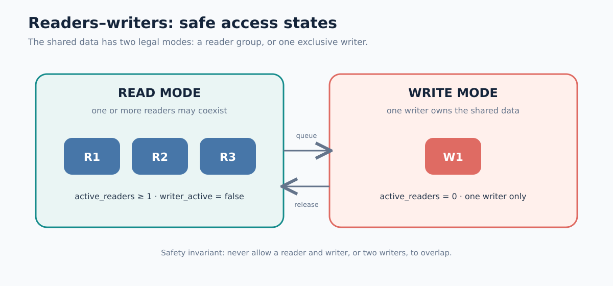
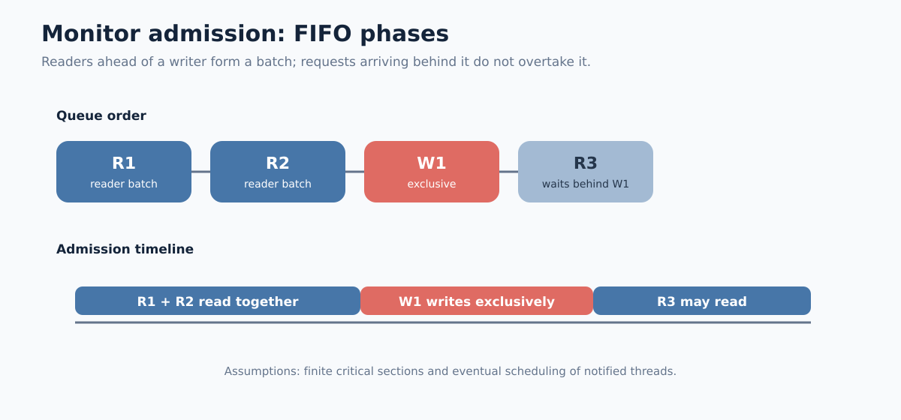

<div dir="rtl" align="right">

# تمرین ۴ — مقایسهٔ Dekker، Peterson، Semaphore و Monitor

## مسئله

در مسئلهٔ خوانندگان و نویسندگان، چند reader می‌توانند هم‌زمان دادهٔ مشترک را بخوانند؛ writer باید دسترسی انحصاری داشته باشد. راه‌حل باید ایمنی (عدم هم‌زمانی reader/writer یا دو writer)، پیشرفت و سیاست انتظار را روشن کند.

## مقایسهٔ کوتاه

| ابزار/الگوریتم | دامنهٔ اصلی | انتظار | نکتهٔ مهم |
|---|---|---|---|
| Dekker | دو فرایند | busy-wait | راه‌حل نرم‌افزاری تاریخی mutual exclusion با فرض atomic read/write و ترتیب حافظهٔ مناسب |
| Peterson | دو فرایند | busy-wait | flag نیت و متغیر turn؛ برای دو فرایند است، نه مستقیماً برای چند reader/writer |
| Semaphore | عمومی | معمولاً blocking | wait/signal اتمی؛ الگوی readers-preference می‌تواند writer را گرسنه کند |
| Monitor | عمومی | condition variable | state و عملیات را کپسوله می‌کند؛ fairness به سیاست صف/notify وابسته است |

Dekker و Peterson را نباید به‌عنوان راه‌حل مستقیم چند reader و writer معرفی کرد. پیاده‌سازی textbook آن‌ها فرض‌هایی دربارهٔ حافظه و عملیات اتمی دارد؛ این مخزن آن‌ها را به‌عنوان الگوریتم هم‌زمان Python اجرا نمی‌کند. برای Semaphore، شبه‌کد readers-preference در راهنمای فنی آمده است. نمونهٔ اجرایی این شاخه یک **monitor با صف ورود FIFO به‌صورت دسته‌های reader** است.

## راهنمای monitor پیاده‌سازی‌شده

```python
from lottery_lab import FairReadersWritersMonitor

rw = FairReadersWritersMonitor()
with rw.read_lock():
    snapshot = read_shared_state()
with rw.write_lock():
    update_shared_state()
```

readerهایی که پیش از writer صف شده‌اند می‌توانند به شکل گروهی وارد شوند. reader تازه‌ای که پشت writer صف شود، از او جلو نمی‌زند. این سیاست، گرسنگی ناشی از ورود بی‌وقفهٔ readerهای جدید را برای writerهای صف‌شده کاهش می‌دهد؛ پیشرفت همچنان فرض می‌کند ناحیه‌های بحرانی متناهی باشند و threadهای بیدارشده اجرا شوند. قفل reentrant نیست و read-to-write upgrade را پشتیبانی نمی‌کند.

## نمودارهای توضیحی

**شکل ۱ — حالت‌های دسترسی:** چند reader می‌توانند با هم فعال باشند، اما writer باید تنها باشد.



**شکل ۲ — صف monitor:** readerهای قبل از writer یک batch می‌سازند و reader بعدی پشت writer می‌ماند.



## آزمون‌ها و مستندات

```bash
python -m pip install -e .
python -m unittest tests.test_readers_writers -v
python -m unittest discover -s tests -v
```

کد در [`src/lottery_lab/readers_writers.py`](../../src/lottery_lab/readers_writers.py) است. تست‌ها ورود هم‌زمان readerها، جلوگیری از هم‌پوشانی writer و reader، و عدم سبقت reader از writer صف‌شده را بررسی می‌کنند. این تست‌ها correctness همهٔ برنامه‌های استفاده‌کننده از قفل را تضمین نمی‌کنند.

توضیح کامل فرض‌ها و شبه‌کد در [`docs/README.md`](docs/README.md)، و یادداشت‌های دوزبانه در `docs/reports/` آمده است. این یادداشت‌ها گزارش ۴۰صفحه‌ای Word/PDF نیستند.

</div>
