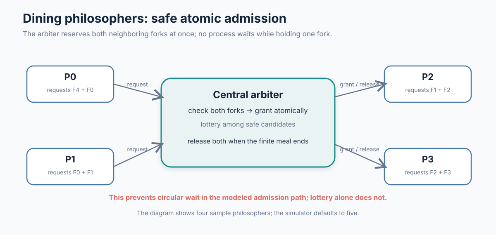
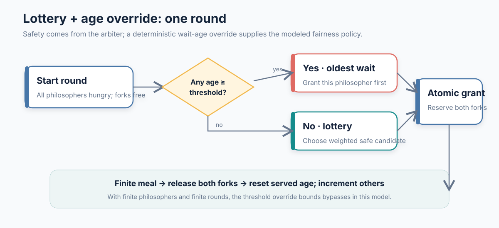
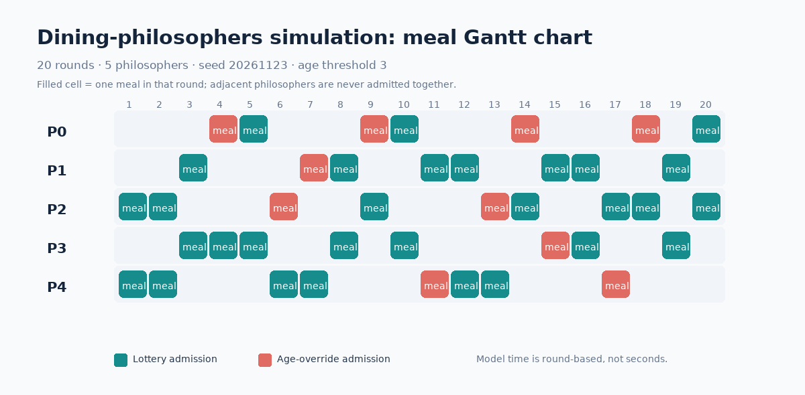

<div dir="rtl" align="right">

# تمرین ۸ — آیا زمان‌بندی لاتاری از بن‌بست و گرسنگی فیلسوفان جلوگیری می‌کند؟

## پاسخ کوتاه

**به‌تنهایی خیر.** Lottery Scheduling تصمیم می‌گیرد کدام پردازه نوبت اجرا بگیرد؛ اما سیاست تخصیص چنگال‌ها را تعریف نمی‌کند. اگر همهٔ فیلسوفان یک چنگال را بگیرند و برای چنگال دوم منتظر بمانند، قرعه‌کشی نمی‌تواند چنگالی را که در اختیار پردازهٔ منتظر است آزاد کند. همچنین انتخاب تصادفی، کران قطعی برای زمان انتظار نمی‌دهد.

منطق لاتاری را می‌توان به عنوان **سیاست انتخاب از میان درخواست‌های مجاز** به‌کار برد. برای جلوگیری از بن‌بست باید تخصیص منابع نیز امن باشد؛ برای تضمین عدم گرسنگی باید قاعدهٔ تقدم/صف یا aging با تضمین صریح اضافه شود. این پوشه نمونهٔ آموزشی «داور با تخصیص اتمی + لاتاری + تقدم انتظار طولانی» را پیاده‌سازی می‌کند.

## مدل مسئله و سیاست پیاده‌سازی‌شده

پنج فیلسوف در یک چرخه، پنج چنگال و یک داور مرکزی مدل می‌شوند. هر دور با آزادبودن چنگال‌ها آغاز می‌شود. داور ابتدا، اگر حد انتظار تعیین‌شده فرارسیده باشد، فیلسوف قدیمی‌تر را انتخاب می‌کند؛ سپس میان فیلسوفانی که با انتخاب‌های همان دور تداخل ندارند قرعه‌کشی وزن‌دار انجام می‌دهد. داور هر دو چنگال مجاور را **هم‌زمان** تخصیص می‌دهد و وعدهٔ غذا در پایان همان دور تمام می‌شود.

این فرض‌های ساده برای تحلیل ایمنی مهم‌اند؛ کد یک برنامهٔ چندریسمانی واقعی نیست. در سیستم واقعی، وضعیت چنگال‌ها و عملیات grant/release باید با قفل یا عملیات اتمی محافظت شوند و زمان غذا/بحرانی متناهی باشد.

## شبه‌کد سیاست پیشنهادی

```text
FOR each round:
    mark all philosophers hungry; all forks are free
    if an age threshold is enabled and some request reached it:
        p ← oldest threshold-qualified philosopher
        atomically reserve both forks adjacent to p
    while a safe, non-conflicting philosopher remains:
        p ← lottery winner among safe candidates (weight = tickets[p])
        atomically reserve both forks adjacent to p
    let admitted philosophers finish one finite meal
    release both forks for each admitted philosopher
    reset served wait ages; increment the others
```

مکانیسم تقدم انتظار طولانی جایگزین خود لاتاری نیست؛ این guard عمداً قرعه‌کشی را برای درخواست‌های قدیمی‌تر override می‌کند.

## تحلیل بن‌بست و گرسنگی

- **بن‌بست در لاتاری ساده:** جلوگیری نمی‌شود. زمان‌بندی صرفاً CPU را میان پردازه‌ها جابه‌جا می‌کند. اگر همه یک چنگال نگه دارند و منتظر چنگال بعدی باشند، انتظار چرخه‌ای همچنان ممکن است.
- **بن‌بست در مدل داور:** با فرض تخصیص اتمی هر دو چنگال، هیچ فیلسوفی یک چنگال را نگه نمی‌دارد و برای دومی منتظر نمی‌ماند؛ بنابراین مسیر hold-and-wait لازم برای این بن‌بست حذف می‌شود. شرط هم‌زمانی داور در برنامهٔ واقعی باید واقعاً atomic باشد.
- **گرسنگی در لاتاری ساده:** تعداد بلیت مثبت، شانس انتخاب را زیاد می‌کند اما حد انتظار قطعی نمی‌دهد. اگر پردازه در هر draw واجد شرایط و احتمال ثابت `p=tᵢ/T` داشته باشد، احتمال انتخاب‌نشدن در `k` draw مستقل برابر `(1-p)^k` است. در زمان‌بندی منابع، مجموعهٔ واجدشرایط ممکن است عوض شود؛ فرمول فقط برای فرض ثابت گفته‌شده است.
- **گرسنگی در نسخهٔ age override:** در مدل دوری محدود با `N` فیلسوف و پایان تضمینی غذا در هر دور، درخواست پس از رسیدن به threshold به انتخاب اولویت‌دار تبدیل می‌شود. در هر دور حداکثر `N-1` درخواست قدیمی‌تر می‌تواند پیش از آن قرار گیرد؛ کران در پیاده‌سازی واقعی به زمان غذا، ورود درخواست‌ها و scheduler وابسته است.

## جدول مقایسهٔ راهکارها

| سیاست | بن‌بست؟ | گرسنگی؟ | دلیل/فرض |
|---|---|---|---|
| لاتاری تنها، بدون پروتکل چنگال | تضمین پیشگیری ندارد | تضمین قطعی ندارد | انتخاب پردازه منبع را آزاد یا اتمی تخصیص نمی‌دهد |
| داور با تخصیص اتمی + لاتاری میان امن‌ها | در مدل از بن‌بست جلوگیری می‌شود | همچنان کران قطعی ندارد | هیچ پردازه‌ای یک چنگال منفرد نگه نمی‌دارد؛ قرعه‌کشی می‌تواند انتظار طولانی بسازد |
| تخصیص اتمی + age override / صف قدیمی‌ترین | در مدل از بن‌بست جلوگیری می‌شود | در فرض‌های مدل، انتظار محدود می‌شود | اولویت‌دادن deterministic به قدیمی‌ترین درخواست از تکرار بی‌نهایت قرعه‌کشی علیه او جلوگیری می‌کند |

این جدول دربارهٔ الگوریتم‌های پیاده‌سازی‌شده و فرض‌های نوشته‌شده است؛ تضمین‌های یک پیاده‌سازی واقعی باید با کد هم‌زمانی و مدل زمان‌بندی آن اثبات شود.

## نمودارها و trace واقعی برنامه

**شکل ۱ — تخصیص اتمی:** درخواست‌ها به داور می‌رسند؛ داور جفت چنگال را یک‌جا رزرو و پس از غذا آزاد می‌کند. تصویر نمونهٔ چهار فیلسوف را برای خوانایی نشان می‌دهد؛ کد پنج فیلسوف دارد.



**شکل ۲ — مسیر لاتاری و تقدم انتظار:** اگر سن انتظار از حد بگذرد، قدیمی‌ترین درخواست اولویت می‌گیرد؛ در غیر این صورت از نامزدهای امن قرعه‌کشی می‌شود. هر دو مسیر به grant اتمی ختم می‌شوند.



**شکل ۳ — نمودار گانت ۲۰ دور:** هر خانهٔ رنگی یک وعدهٔ کامل‌شده از خروجی برنامه است؛ فیروزه‌ای یعنی پذیرش لاتاری و مرجانی یعنی تقدم age override. زمان افقی «دور شبیه‌سازی» است، نه ثانیه.



فایل دادهٔ همین شکل [`outputs/philosopher-rounds.csv`](outputs/philosopher-rounds.csv) است. با seed `20261123` و حد انتظار ۳، اجرای ۱۲دوری مثال شمار وعده‌های `(4, 5, 4, 5, 6)` را برای `P0..P4` گزارش کرد؛ این فقط یک trace مشخص است.

## اجرا و آزمون

```bash
python -m pip install -e .
python examples/run_philosophers_demo.py
python -m unittest discover -s tests -v
python -m pip install -e ".[docs]"
python tools/generate_figures.py
```

ماژول اصلی [`src/lottery_lab/philosophers.py`](../../src/lottery_lab/philosophers.py) است. تست‌های `tests/test_philosophers.py` عدم مجاورت غذاخورها، بیشینه‌بودن مجموعهٔ امن، تکرارپذیری seed، ورودی‌های مرزی و guard انتظار را بررسی می‌کنند. تست‌ها اجرای concurrent واقعی را اثبات نمی‌کنند.

## نتیجه و محدودیت گزارش

نتیجهٔ علمی این تمرین این است که **لاتاری به تنهایی راهکار پیشگیری از بن‌بست یا تضمین حذف گرسنگی نیست**؛ می‌تواند فقط یکی از سیاست‌های انتخاب باشد. ایمنی این مدل از داور و grant اتمی می‌آید و fairness محدودش از age override، نه از random draw به‌تنهایی.

در مخزن آغازین کد، پارامتر آزمایش یا گزارش وجود نداشت. گزارش‌های Markdown اینجا مستند به پیاده‌سازی تازه هستند، اما فایل Word/PDF سی‌وپنج تا چهل‌صفحه‌ای تولید نشده است. برای تحویل کامل دانشگاهی، باید دامنهٔ مورد قبول استاد، منابع تأییدشده، و الزامات قالب‌بندی ارائه شود؛ از پرکردن صفحه با متن یا دادهٔ ساختگی خودداری شده است.

</div>
